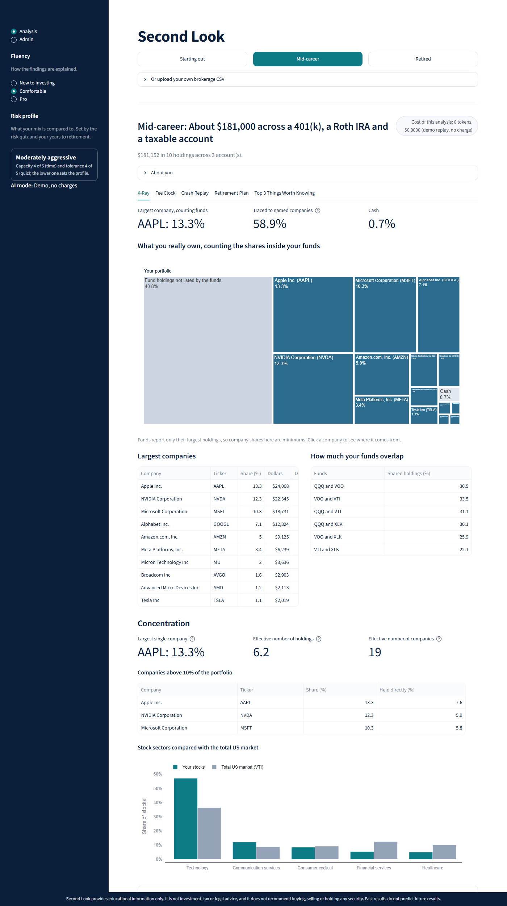

# Second Look

Second Look reads a brokerage export of your investments and shows what you really own (including the companies hidden inside your funds), what your fees cost over time, how your mix would have held up in past crashes, and whether you are on track for retirement. Every number is calculated in plain Python; an AI only explains those numbers in everyday language, at the level you choose, and it never tells you to buy, sell or hold anything.



More screenshots are in [`docs/screenshots/`](docs/screenshots/).

> **Not investment advice.** Second Look provides educational information only. It is not investment, tax or legal advice, and it does not recommend buying, selling or holding any security. Past results do not predict future results. Talk to a fiduciary financial advisor before making decisions.

---

## What you need first

You need two free programs. If you already have them, skip ahead.

| Program | Why | How to get it |
|---|---|---|
| **Python 3.12** (3.11 or 3.13 also work) | Runs the app | Download Python 3.12 from [python.org/downloads](https://www.python.org/downloads/) (scroll to "Looking for a specific release?"). **Windows:** on the first installer screen, tick **"Add python.exe to PATH"** before clicking Install. Newer is not better here: with Python 3.14, Windows 11's Smart App Control can block one of the add-ons (see [Troubleshooting](#troubleshooting)). |
| **Git** | Downloads the code | **Windows:** [git-scm.com/download/win](https://git-scm.com/download/win) (the default options are fine). **macOS:** open Terminal and run `xcode-select --install`. |

You do **not** need an AI key. Without one, the app runs in free demo mode.

All the steps below are typed into a terminal:
- **macOS:** open **Terminal** (press Cmd+Space, type "Terminal", press Return).
- **Windows:** open **PowerShell** (click Start, type "PowerShell", press Enter).

Type each command, press Enter, and wait for it to finish before typing the next one.

---

## Install and run on macOS

1. **Check Python.** You should see `Python 3.12` (3.11 or 3.13 also work).
   ```bash
   python3 --version
   ```
2. **Download the code** and go into its folder. Replace the address with the repository link you were given.
   ```bash
   git clone https://github.com/YOUR-ACCOUNT/second-look.git
   cd second-look
   ```
3. **Create a virtual environment** (a private folder for this app's add-ons, so nothing else on your computer changes).
   ```bash
   python3 -m venv .venv
   ```
4. **Turn it on.** Your prompt now starts with `(.venv)`. Do this again every time you open a new Terminal window.
   ```bash
   source .venv/bin/activate
   ```
5. **Install the add-ons.** This takes a few minutes the first time.
   ```bash
   pip install -r requirements.txt
   ```
6. **Create your settings file** by copying the example.
   ```bash
   cp .env.example .env
   ```
7. **Optional: add a Portkey key** for live AI explanations. Skip this step to run free in demo mode. Open the file with `open -e .env`, replace `your-key-here` with your own key and `true` with `false` on these two lines, then save and close:
   ```
   PORTKEY_API_KEY=your-key-here
   DEMO_MODE=true
   ```
8. **Start the app.** Your browser opens at http://localhost:8501. To stop the app, click the Terminal window and press Ctrl+C.
   ```bash
   streamlit run app.py
   ```

## Install and run on Windows

1. **Check Python.** You should see `Python 3.12` followed by more numbers. (The `-3.12` picks that version even if you have others installed.)
   ```powershell
   py -3.12 --version
   ```
2. **Download the code** and go into its folder. Replace the address with the repository link you were given.
   ```powershell
   git clone https://github.com/YOUR-ACCOUNT/second-look.git
   cd second-look
   ```
3. **Create a virtual environment** (a private folder for this app's add-ons, so nothing else on your computer changes).
   ```powershell
   py -3.12 -m venv .venv
   ```
4. **Turn it on.** Your prompt now starts with `(.venv)`. Do this again every time you open a new PowerShell window. (If you see "running scripts is disabled", see [Troubleshooting](#troubleshooting).)
   ```powershell
   .venv\Scripts\Activate.ps1
   ```
5. **Install the add-ons.** This takes a few minutes the first time.
   ```powershell
   pip install -r requirements.txt
   ```
6. **Create your settings file** by copying the example.
   ```powershell
   copy .env.example .env
   ```
7. **Optional: add a Portkey key** for live AI explanations. Skip this step to run free in demo mode. Open the file with `notepad .env`, replace `your-key-here` with your own key and `true` with `false` on these two lines, then save and close:
   ```
   PORTKEY_API_KEY=your-key-here
   DEMO_MODE=true
   ```
8. **Start the app.** Your browser opens at http://localhost:8501. To stop the app, click the PowerShell window and press Ctrl+C.
   ```powershell
   streamlit run app.py
   ```

## Using the app

- Click **Starting out**, **Mid-career** or **Retired** to explore a sample portfolio, or open **Or upload your own brokerage CSV** and add one file per account.
- Fill in **About you** (age, retirement goal, Social Security estimate, and a five-question risk quiz). Samples come pre-filled.
- Choose how things are explained under **Fluency** in the left sidebar: *New to investing*, *Comfortable* or *Pro*. The **Risk profile** badge below it shows what your mix is compared to.
- Tabs: **X-Ray** (what you really own), **Fee Clock** (what fees cost), **Crash Replay** (past crises), **Retirement Plan** (with adjustable assumptions), **Top 3 Things Worth Knowing** (the AI explanation).
- The **Pause button** shows what a trade you are considering would change, and what happened to people who made similar moves in past crashes. It never says whether to do it.

**Demo mode** (the default, `DEMO_MODE=true`) costs nothing and needs no key. It replays saved AI explanations for the three sample portfolios. For your own uploads, or if you change a sample's answers, it shows a standard summary built straight from the numbers instead.

**Your privacy:** uploaded files are processed in memory and never saved. Account numbers and descriptions are removed before anything reaches the AI, and the AI only sees computed numbers.

---

## Troubleshooting

**1. "python3: command not found" (macOS) or "py is not recognized" / "Python was not found" (Windows)**
Python is not installed, or the terminal cannot find it. Install it from [python.org/downloads](https://www.python.org/downloads/). On Windows, run the installer again, choose **Modify**, and make sure **"Add python.exe to PATH"** is ticked; also turn off the "App execution aliases" for python in Windows Settings > Apps > Advanced app settings. Then close and reopen the terminal.

**2. "running scripts is disabled on this system" (Windows, step 4)**
PowerShell blocks the activation script by default. Allow scripts you run yourself, then repeat step 4:
```powershell
Set-ExecutionPolicy -Scope CurrentUser RemoteSigned
```
Answer **Y** if asked. (Alternatively use Command Prompt and run `.venv\Scripts\activate.bat`.)

**3. Wrong Python version: `pip install` says "No matching distribution found", or the app or tests fail with "DLL load failed ... An Application Control policy has blocked this file"**
The first message means your Python is too old. The second is Windows 11's **Smart App Control** refusing to load part of the `pyarrow` add-on built for a very new Python (3.14), which breaks the sample portfolios and price charts. Either way, use **Python 3.12**: install it (see [What you need first](#what-you-need-first)), delete the `.venv` folder, and redo steps 3 to 5 (`py -3.12 -m venv .venv` on Windows). Do not turn off Smart App Control to work around it.

**4. "streamlit: command not found" / "streamlit is not recognized", or "Port 8501 is already in use"**
The virtual environment is not turned on: repeat step 4 (your prompt should start with `(.venv)`), or run `python -m streamlit run app.py`. If the port is busy because the app is already running in another window, either use that window or start a second copy on another port: `streamlit run app.py --server.port 8502`.

**Also good to know:** if the Top 3 tab says it is showing "the standard summary", the AI was not used (demo mode without a saved answer, no key, or a spending limit reached). The numbers are the same either way.

---

## Running the tests

With the virtual environment turned on (step 4):
```bash
python -m pytest
```
About 400 tests run in under a minute, with no AI key and no internet needed. Other checks:

| Command | What it does | Cost |
|---|---|---|
| `python scripts/check_demo.py` | Confirms demo mode works with no key, for $0 | Free |
| `python scripts/run_redteam.py` | 53 safety checks: adversarial prompts, malicious CSVs, wrong-number drafts. Results in `docs/redteam_results.json` | Free (add `--live` for real AI calls, about $0.01) |
| `python scripts/measure_costs.py` | Measures real AI costs (27 analyses + 5 pause checks). Results in `docs/cost_results.md` | About $0.04, stops before $1.00 |
| `python scripts/record_demo.py` | Re-records the demo-mode AI answers | About $0.01 |

The last three need a Portkey key. Optional for contributors: `pre-commit install` adds a secret scan (gitleaks) to every commit.

---

## Cost harness settings

Every AI call goes through a budget check first and is recorded in a local ledger (`.runtime/ledger.db`); the **Admin** page in the sidebar shows the totals. The limits are set in `.env`:

| Setting | Default | Meaning |
|---|---|---|
| `DEMO_MODE` | `true` | `true` replays saved answers for free; `false` makes live AI calls (needs a key) |
| `PORTKEY_API_KEY` | `your-key-here` | Your own Portkey key. Keep it only in `.env`, which git never uploads |
| `MODEL_FAST` / `MODEL_SMART` | `gpt-6-luna` | Models for quick checks / explanations |
| `SESSION_BUDGET_USD` | `0.10` | Most one visit can spend |
| `DAILY_BUDGET_USD` | `2.00` | Most the app can spend per day, across everyone |
| `MAX_TOKENS_PER_CALL` | `1500` | Longest answer any one AI call may write |
| `MAX_COST_PER_CALL_USD` | `0.05` | Most any one AI call may cost (worst case) |
| `REASONING_EFFORT` | `low` | How much the model "thinks" before answering; `low` is faster, cheaper and more reliable here |
| `PORTKEY_PROVIDER` | `openai` | Provider name passed to Portkey |

Prices per model are in `secondlook/budget.py` (gpt-6-luna: $0.10 per million input tokens, $0.50 per million output tokens). When a limit is reached, the app says so and shows a saved or standard explanation instead.

**Measured cost** (see [`docs/cost_results.md`](docs/cost_results.md)): about **$0.0012 per full analysis** with gpt-6-luna, or roughly **$24 a month for 10,000 users** at two analyses each.

---

## Data limitations

- **Fund holdings are top 10 only.** Data providers list only a fund's largest holdings, so "how much of a company you really own" is a minimum; the true share can be higher.
- **Prices come from Yahoo Finance (yfinance)**, an unofficial free source that can be delayed, incomplete or briefly unavailable. The app tries live data first and falls back to an offline snapshot with prices through **2026-10-16**. Sample portfolios always use the snapshot.
- **Crash replays describe the past, not the future.** They hold today's mix constant through past crises; holdings that did not exist yet use stated stand-ins (for example VOO uses SPY before 2010).
- **Retirement numbers are planning estimates, not guarantees.** They use simple assumptions (constant real returns, a 3.9% withdrawal rate, a flat 15% tax on pre-tax accounts), all adjustable in the Assumptions drawer. No other taxes are modeled.
- **Reference data are placeholders until cited.** The stock ranges per risk profile (`data/reference/risk_profile_ranges.json`) are illustrative rules of thumb, and the target-date glide path (`data/reference/glide_path.json`) is empty until filled in from a cited source.
- **Sample portfolios and personas are made up.** Their account numbers (`DEMO-0000-…`) are fake.

---

## How it works (for developers)

```
app.py                     Streamlit interface
secondlook/quant/          All calculations (parsing, look-through, fees, crash replay, plan, concentration, Facts JSON)
secondlook/agents/         AI agents; each has its prompt in agents/prompts/*.md
secondlook/orchestrator.py analyst -> explainer -> verifier, one rewrite, then a safe template; max 4 AI calls
secondlook/safety/         Advice guard, number matching, secret scanner
secondlook/llm.py          The only code that calls Portkey (budget, cache, retry, demo replay)
secondlook/config.py       The only code that reads settings from .env
data/                      Sample portfolios, personas, offline market snapshot, reference data
demo/recorded/             Saved AI answers for demo mode
tests/                     pytest suite, including tests/redteam/
```

### Sample portfolios

`data/sample_portfolios/` holds three made-up portfolios in a common brokerage export format (`Symbol, Description, Quantity, Price, Market Value, Account Number`), with personas in `personas.json`.

| File | Size | What it shows |
|---|---|---|
| `beginner.csv` | ~$15k | A target-date fund (VTTSX) plus a few popular stocks |
| `midcareer.csv` | ~$181k | Overlapping funds (VOO, VTI, QQQ, XLK) plus big-tech stocks: hidden concentration in the same few companies |
| `retiree.csv` | ~$657k | Stock and bond index funds, dividend stocks, and a high-cost active fund (GFACX, 1.35% expense ratio) |

### Market data snapshot

`secondlook/market_data.py` fetches from yfinance first and falls back to `data/snapshot/` (daily prices from 2007 and fund profiles for every sample ticker plus the crash-replay stand-ins `^GSPC`, `^IXIC`, `SPY`, `QQQ`, `IWM`, `EFA`, `AGG`, `TLT`, `GLD`). Rebuild it (about a minute, needs internet) with `python scripts/build_snapshot.py`.

| Field | Coverage |
|---|---|
| `top_holdings` (symbol, name, weight) | **Top holdings only** (XLK's top 10 are about 65% of the fund, VOO's about 39%, VTI's about 34%) |
| Look-through exposure to one company | **Top holdings only**, so it is a floor |
| `sector_weights`, `asset_classes`, `expense_ratio` | Whole fund |

Some funds report no holdings at all (BND, TLT, GLD), and target-date funds such as VTTSX list their underlying funds rather than stocks.

### Planning assumptions

Withdrawal rate, real returns and the flat tax rate live in `ASSUMPTIONS` in `secondlook/quant/plan.py`; every one is repeated as a labeled value in the Facts JSON the AI receives.
